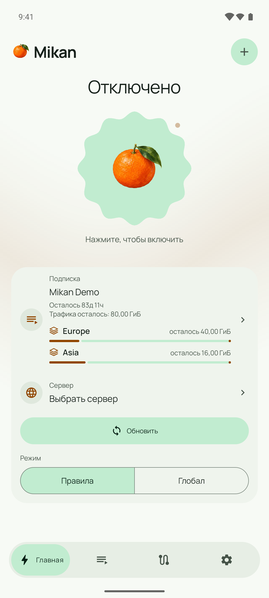
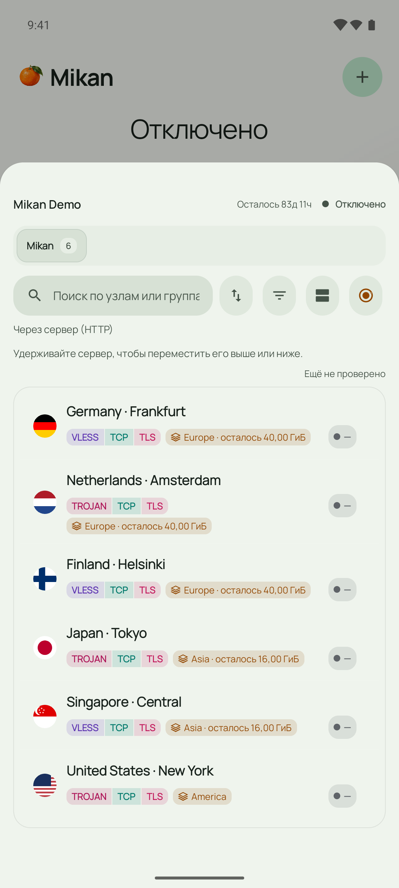
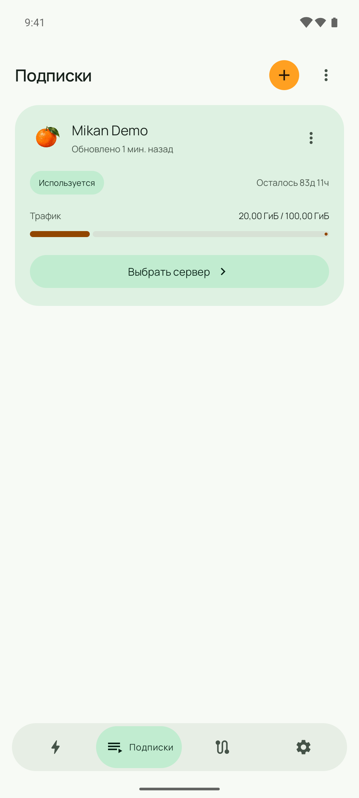
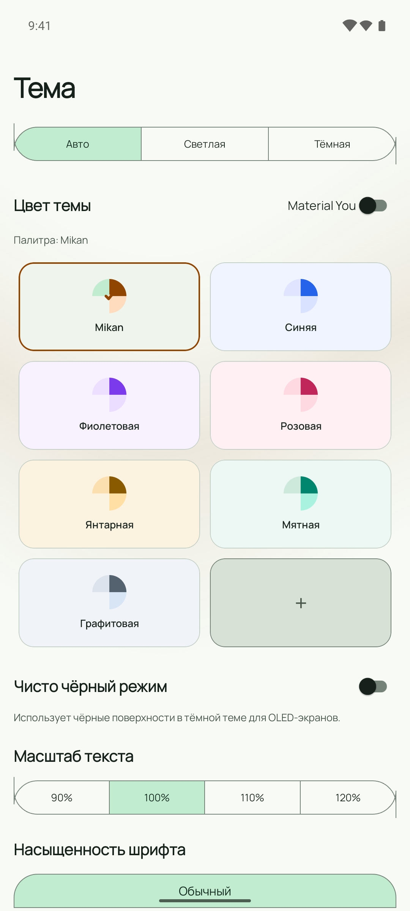
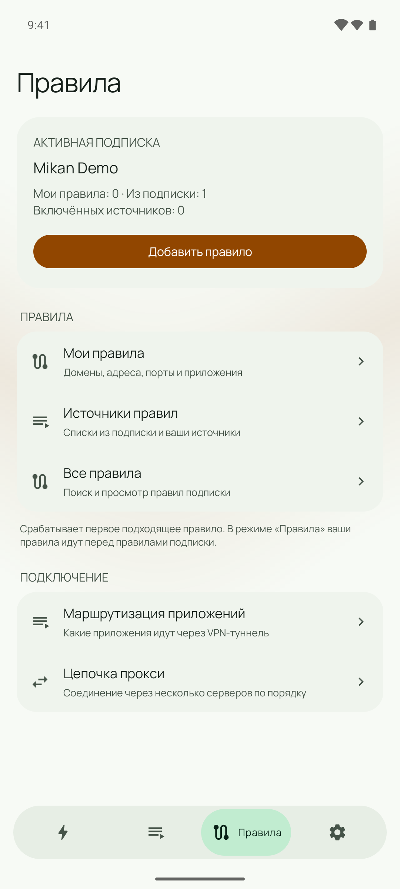
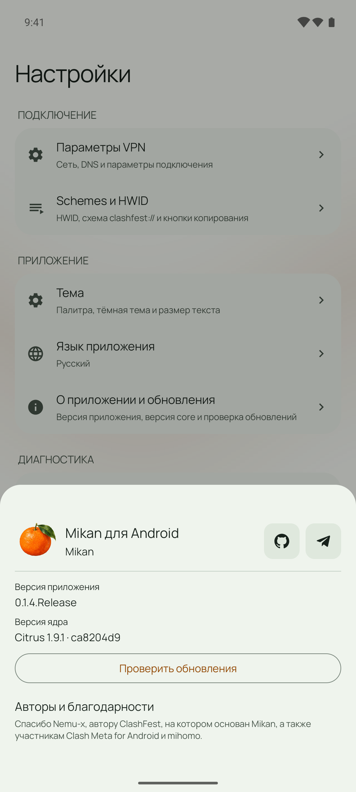

<p align="center">
  
</p>

<h1 align="center">Mikan for Android</h1>

<p align="center">
  A Material 3 VPN client powered by <a href="https://github.com/getmikan/Citrus">Citrus</a>.<br />
  Your subscriptions, servers and routing in one place.
</p>

<p align="center">
  <a href="https://github.com/getmikan/MikanApp/releases">Download</a> ·
  <a href="https://github.com/getmikan/MikanApp/issues">Issues</a> ·
  <a href="https://t.me/mikanvpn">News</a> ·
  <a href="ROADMAP.md">Roadmap</a>
</p>

**Mikan** is an open-source Android VPN and proxy client. It runs **Citrus**,
Mikan's core based on [mihomo](https://github.com/MetaCubeX/mihomo), and works
with compatible Clash / Clash.Meta subscriptions and configuration files.
Mikan is a client: bring a subscription or your own server configuration.

The current interface uses expressive Material 3 surfaces, an animated mandarin
connection button, country flags and a compact navigation capsule. Light, dark,
OLED and preset palettes share the same screens and controls.

## Download and update

Signed releases and release notes: **[GitHub Releases](https://github.com/getmikan/MikanApp/releases)**.

| Device | APK |
| --- | --- |
| Modern Android phone or tablet (ARM64) | [mikan-alpha-arm64-v8a.apk](https://github.com/getmikan/MikanApp/releases/latest/download/mikan-alpha-arm64-v8a.apk) |
| All supported architectures | [mikan-alpha-universal.apk](https://github.com/getmikan/MikanApp/releases/latest/download/mikan-alpha-universal.apk) |
| 32-bit ARM | [mikan-alpha-armeabi-v7a.apk](https://github.com/getmikan/MikanApp/releases/latest/download/mikan-alpha-armeabi-v7a.apk) |
| x86_64 | [mikan-alpha-x86_64.apk](https://github.com/getmikan/MikanApp/releases/latest/download/mikan-alpha-x86_64.apk) |
| 32-bit x86 | [mikan-alpha-x86.apk](https://github.com/getmikan/MikanApp/releases/latest/download/mikan-alpha-x86.apk) |

The `alpha` in filenames names the build flavor. Current release builds use
**`io.github.miroshka000.mikan`**, without an `.alpha` suffix. The former
`com.nemu.clashfest.clash.alpha` package is a separate installation; export a
backup before moving between package IDs.

Check for APK updates in **Settings → About & updates**. Install a compatible
signed APK over the existing installation to retain subscriptions and settings.
Updating between Google Play and GitHub also requires matching signing
certificates or a valid signing-key rotation; a matching package ID alone is
insufficient. APK checksums are included with each GitHub release.

Signed beta builds appear as pre-releases. Development builds from `dev` are
[separate debug-signed artifacts](https://github.com/getmikan/MikanApp/releases/tag/dev-latest)
and cannot replace a release-signed installation.

## What Mikan does

| Area | Features |
| --- | --- |
| Connection | One-tap VPN control, a home-screen widget and Quick Settings tile |
| Subscriptions | Import from a URL, QR code, clipboard or file; refresh feedback and retry actions |
| Mikan panels | `mikan://` import links, server groups and per-group traffic when supplied by a compatible panel |
| Servers | Country flags, search, group filters, protocol/transport badges, latency checks and saved ordering |
| Routing | Rule / Global modes, custom rules, per-app VPN routing and proxy chains |
| DNS and geodata | Per-profile DNS / hosts editing, GeoIP / GeoSite sources and local database import |
| Visibility | Live connections and core logs |
| Appearance | Light, dark and OLED modes, preset and custom colors, text settings, calm or animated backgrounds |
| Devices | Phone, tablet and Android TV layouts; Companion pairing for remote control |

Subscription configuration and user edits are stored separately. Mikan composes
them when applying a profile and validates the result with the actual core.
Built-in network hardening and APK update identity/signature checks remain enabled.

## Current interface

These captures show the current Mikan interface introduced in the 0.1.3 beta
series and included in 0.1.4. They use a demonstration subscription.

<table>
  <tr>
    <td width="50%" align="center"><br /><b>Home</b></td>
    <td width="50%" align="center"><br /><b>Servers</b></td>
  </tr>
  <tr>
    <td width="50%" align="center"><br /><b>Subscriptions</b></td>
    <td width="50%" align="center"><br /><b>Appearance</b></td>
  </tr>
  <tr>
    <td width="50%" align="center"><br /><b>Rules</b></td>
    <td width="50%" align="center"><br /><b>Mikan + Citrus</b></td>
  </tr>
</table>

<details><summary>По-русски</summary>

**Mikan** — открытый VPN-клиент для Android с ядром **Citrus**, основанным на
mihomo. Добавьте совместимую подписку или конфигурацию своего сервера, выберите
сервер и включите VPN. Приложение само по себе не выдаёт подписку или VPN-сервер.

В версии 0.1.4 собраны изменения beta-серии: интерфейс Material 3 с анимированным
мандарином, новая нижняя навигация, палитры, флаги стран, группы серверов и их
трафик для совместимых панелей Mikan. Доступны маршрутизация по приложениям,
свои правила, DNS, цепочки прокси, логи и соединения.

Для современного телефона выбирайте **arm64-v8a**, универсальный APK содержит
все архитектуры. Обновляйтесь через «Настройки → О приложении и обновления» или
совместимым подписанным APK поверх установленного приложения. Для перехода со
старого ID `com.nemu.clashfest.clash.alpha` сначала экспортируйте резервную копию.
При переходе между Google Play и GitHub должна совпадать также подпись приложения.

</details>

## Build

Requirements: **JDK 21**, Android SDK **36**, Build Tools **35.0.0**, NDK
**29.0.14206865**, CMake and a compatible Go **1.26** toolchain. The checked-in
wrapper uses Gradle **8.11.1** and Android Gradle Plugin **8.10.1**. Direct APKs
support Android 5.0 / API 21. Google Play bundles require Android 7.0 / API 24
to support Play automatic protection.

```sh
git clone --recurse-submodules https://github.com/getmikan/MikanApp.git
cd MikanApp
```

Set `sdk.dir` in the ignored `local.properties` file. To match the official
release package, also set:

```properties
custom.application.id=io.github.miroshka000.mikan
remove.suffix=true
```

Use the checked-in wrapper (`gradlew.bat` on Windows):

```sh
./gradlew assembleAlphaDebug
./gradlew :app:assembleAlphaRelease
./gradlew :app:bundlePlayRelease
```

Release builds require the private `release.keystore` and ignored
`signing.properties` containing `keystore.password`, `key.alias` and
`key.password`. Reuse the existing key for updates. Never commit signing files.
Release APKs and AABs are optimized and resource-shrunk.

Run APK and AAB packaging separately. APK tasks produce the four ABI-specific
APKs plus a universal APK; bundle tasks disable APK splits and let Google Play
generate device-specific APKs from the AAB.

This branch uses the dedicated `play` flavor for Google Play. It keeps the
`io.github.miroshka000.mikan` package, requires Android 7.0 / API 24 and receives
updates through Google Play. The Play manifest removes the APK installation
permission and disables the GitHub updater. Upload the AAB from
`app/build/outputs/bundle/playRelease/`.

The core is pinned through `core/src/foss/golang/clash`; its current source is
[getmikan/Citrus](https://github.com/getmikan/Citrus). Initialize submodules before
building. Use the Go runtime patches and embedded Root CA preparation from
`.github/workflows/release.yml`; Windows builders must supply an equivalent
non-empty CA bundle before compiling the native libraries. Build-time bundled
geodata is checked against the committed hashes.

Tagged GitHub releases use the `production-release` environment with
`ANDROID_KEYSTORE_BASE64`, `ANDROID_KEYSTORE_PASSWORD`, `ANDROID_KEY_ALIAS` and
`ANDROID_KEY_PASSWORD`. The workflow verifies package identity, version and
signing certificate before publishing APKs.

## Source layout

| Module | Purpose |
| --- | --- |
| `app/` | Activities, imports, updates and packaging |
| `design/` | Material 3 XML Views, palettes, animations and dialogs |
| `common/` | Shared models, utilities and Android compatibility |
| `core/` | JNI bridge and pinned Citrus core |
| `service/` | VPN service, subscriptions, configuration composition and routing |
| `clash-companion/` | Companion protocol and remote-control tooling |

## Branding and contributors

Mikan is developed in [getmikan/MikanApp](https://github.com/getmikan/MikanApp).
The painted mandarin is shared with the Mikan panel. Source assets live under
`design/`; Android brand assets are generated with
`node packaging/branding/generate.cjs`.

Mikan is based on [ClashFest](https://github.com/Nemu-x/ClashFest) by
[Nemu-x](https://github.com/Nemu-x), which builds on
[Clash Meta for Android](https://github.com/MetaCubeX/ClashMetaForAndroid).
Citrus builds on [mihomo](https://github.com/MetaCubeX/mihomo). We thank the
contributors to these projects and preserve their original copyright notices.
Geo data presets use [Meta rules dat](https://github.com/MetaCubeX/meta-rules-dat).

Licensed under **GNU GPL v3.0**. See [LICENSE](LICENSE) and [NOTICE](NOTICE).
